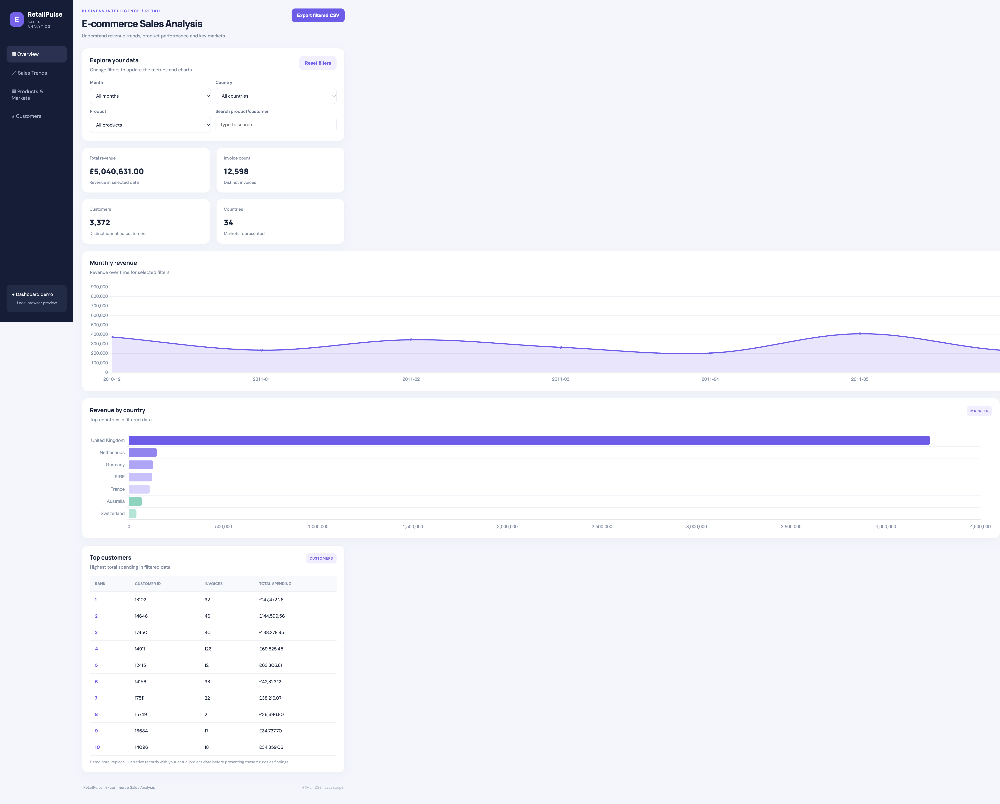

# 🛒 E-commerce Sales Analysis Dashboard

An interactive **E-commerce Sales Analysis Dashboard** built using HTML, CSS, JavaScript, and Chart.js. This project analyzes the **UCI Online Retail Dataset** to explore sales performance, revenue trends, customer behavior, and product performance.

<p align="center">
  <strong>📊 Turning Retail Transactions into Actionable Insights</strong>
</p>

---

## 📌 Project Overview

The E-commerce Sales Analysis Dashboard provides an interactive interface for exploring retail transaction data from December 2010 to December 2011. It helps users identify sales trends, discover top-performing countries and products, and analyze customer purchasing patterns through charts, KPIs, and filters.

## 🌐 Live Demo

🚀 **View Dashboard:** (https://kumarnitinx05.github.io/E-commerce-Sales-Analysis/)

## 👥 Project Team

- **Nitin Kumar** — A357175125015
- **Prince Kumar** — A357175125001

*Department of Computer Science & Engineering, Amity University Jharkhand*

---

## ⚡ Key Features

### 1. 📊 Sales Performance KPIs

- **Total Revenue:** Displays revenue calculated from transaction quantities and unit prices.
- **Total Orders:** Shows the number of orders in the selected dataset.
- **Total Customers:** Displays the number of unique customers.
- **Total Countries:** Shows the number of countries represented in the data.

### 2. 📈 Interactive Data Visualizations

- **Monthly Revenue Trend:** Analyzes revenue changes over time.
- **Top Countries:** Identifies countries with the highest sales.
- **Top Products:** Highlights the best-performing products.
- **Top 10 Customers:** Displays high-value customers in a table.

### 3. 🔎 Filters and Data Export

- **Month Filter:** Explore sales for a selected month.
- **Country Filter:** Analyze sales by country.
- **Product Filter:** Focus on specific products.
- **Search Box:** Quickly find relevant data.
- **Reset Button:** Restore the default dashboard view.
- **Export CSV:** Export filtered data for further analysis.

---

## 🛠️ Technologies Used

| Technology | Purpose |
|---|---|
| HTML5 | Dashboard structure |
| CSS3 | Styling and responsive layout |
| JavaScript | Data processing and interactive functionality |
| Chart.js | Data visualization |
| CSV | Retail transaction data |
| Python HTTP Server / VS Code Live Server | Local development and testing |

---

## 🚀 Getting Started

### Prerequisites

- A modern web browser.
- Visual Studio Code (recommended).
- Python 3 or the VS Code Live Server extension.
- An internet connection to load Chart.js from its CDN.

### Installation and Setup

**Step 1: Clone the repository**

```bash
git clone https://github.com/kumarnitinx05/E-commerce-Sales-Analysis.git

**Step 2: Open the project folder**

```bash
cd E-commerce-Sales-Analysis
```

Open this folder in VS Code.

**Step 3: Start the local server**

Option A — Use the VS Code Live Server extension. Right-click `index.html` and select **Open with Live Server**.

Option B — Run Python in the project directory:

```bash
python3 -m http.server 8000
```

**Step 4: Open the dashboard**

Visit [http://localhost:8000](http://localhost:8000) in your browser.

> **Important:** Use a local server instead of opening `index.html` directly if your browser blocks access to the CSV file.

---

## 📂 Dataset

- **Dataset:** UCI Online Retail Dataset
- **File:** `online_retail.csv`
- **Period:** December 2010 – December 2011
- **Data Type:** Retail transactions

### Revenue Calculation

Revenue is calculated using:

**Revenue = Quantity × Unit Price**

Negative quantities, commonly associated with returns, can reduce the calculated revenue. The actual treatment of cancelled invoices and other records depends on the dashboard's data-processing logic.

---

## 📁 Repository Structure

```text
E-commerce-Sales-Analysis/
│
├── index.html          # Main dashboard interface
├── styles.css          # Dashboard styling
├── app.js           # Dashboard logic and interactivity
├── online_retail.csv   # Retail transaction dataset
└── README.md           # Project documentation
```

*Ensure that the filenames in this tree match the actual files in your repository.*

---

## 🎯 Project Objectives

1. Analyze e-commerce sales performance using transaction data.
2. Identify top-performing products and countries.
3. Understand monthly revenue trends.
4. Explore customer purchasing patterns.
5. Enable interactive data filtering and searching.
6. Export filtered records for further analysis.

---

## 📸 Dashboard Preview

## 📸 Dashboard Preview



## 🔮 Future Enhancements

- Add date-range filtering.
- Include product-category analysis where category data is available.
- Add more detailed customer segmentation.
- Improve mobile responsiveness.
- Deploy the dashboard online for public access.

---

*Developed as an academic project to explore e-commerce analytics, data visualization, and interactive dashboard development.*
